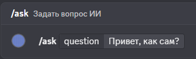
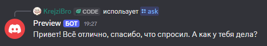

# Discord AI Bot

<p align="center">
  <a href="https://discord.com"></a>
  <a href="https://groq.com"></a>
  <a href="https://python.org"></a>
  <a href="https://docs.aiohttp.org"></a>
  <a href="LICENSE"></a>
</p>

Высокоскоростной Discord бот-ассистент с интеграцией аппаратного инференса нейросетей через сверхбыстрый Groq LPU API.

Минималистичный шаблон и готовая масштабируемая основа для персонального или серверного AI-помощника: нативные слеш-команды Discord, неблокирующая асинхронная архитектура и автоматическая обработка ответов любого объема.

<p align="center">
  
  &nbsp;
  
</p>

## Основные возможности

* **Нативные слеш-команды**: Удобное взаимодействие пользователей через встроенную слеш-команду `/ask` с подсказками аргументов.
* **Сверхбыстрый инференс (Groq API)**: Время отклика исчисляется миллисекундами благодаря специализированным процессорам Groq LPU.
* **Полная асинхронность**: Обработка сетевых запросов через `aiohttp` внутри цикла событий `asyncio` — бот никогда не зависает и не блокирует другие команды.
* **Обход лимитов Discord**: При превышении стандартного лимита сообщения в 2000 символов бот автоматически генерирует и отправляет чистый форматированный текстовый `.txt` файл.
* **Модульная система промптов**: Легкая смена характера, ролевой модели и системных инструкций бота через переменную `SYSTEM_PROMPT`.

## Поддерживаемые модели

Вы можете переключить целевую языковую модель в одну строчку в файле `bot.py`:

| Модель | Назначение |
|---|---|
| `openai/gpt-oss-20b` | Быстрая универсальная модель (по умолчанию) |
| `openai/gpt-oss-120b` | Продвинутые рассуждения и сложная логика |
| `llama-3.1-70b-versatile` | Флагманская модель Meta с глубоким контекстом |
| `llama3-8b-8192` | Ультралегкая и моментальная модель |
| `qwen/qwen3.8-27b` | Мощная мультиязычная модель |
| `mixtral-8x7b-32768` | Архитектура Mixture of Experts с окном 32k |
| `gemma2-9b-it` | Эффективная компактная модель от Google |

## Быстрый старт

### 1. Установка зависимостей
```bash
pip install discord.py aiohttp
```

### 2. Настройка конфигурации
Откройте `bot.py` и укажите ваши ключи доступа:
* `DISCORD_TOKEN`: токен вашего Discord бота (получается на [Discord Developer Portal](https://discord.com/developers/applications))
* `GROQ_API_KEY`: API ключ Groq (создается бесплатно в [Groq Console](https://console.groq.com/keys))

### 3. Запуск бота
```bash
python bot.py
```

## Безопасность и промпты

В репозитории предусмотрен файл `security_prompt.txt` с примером многоуровневых инструкций по защите системного контекста от базовых атак инъекции промптов (Prompt Injection / Jailbreak).

> [!NOTE]
> Текстовые инструкции приведены в ознакомительных целях. Настройте системный промпт под конкретные задачи вашего сообщества.

## Сообщество и поддержка

* Официальный Telegram канал разработчика: https://t.me/KreziBro_dev
* Поддержать развитие проекта на платформе Ko-fi: https://ko-fi.com/krejzibro

## Лицензия

Распространяется под лицензией MIT. Подробности в файле [LICENSE](LICENSE).
